<div align="center">
  
  <h1>Sparrow Kit</h1>
  <p><strong>Real HTML. Server-rendered with Dart.</strong></p>
  <p>Write supported Flutter-style UI in Dart. Build native web output with Sparrow Kit.</p>
  <p>
    <a href="https://dart.dev"></a>
    <a href="https://dart.dev"></a>
    <a href="LICENSE"></a>
  </p>
</div>

<p align="center">
  <a href="#developer-experience">Developer experience</a> ·
  <a href="#quick-start">Quick start</a> ·
  <a href="#widget-compatibility">Compatibility</a> ·
  <a href="#architecture">Architecture</a> ·
  <a href="#documentation">Documentation</a>
</p>

---

## What is Sparrow Kit?

Sparrow Kit is a Dart-first web framework with an integrated CLI and an
Analyzer-based compiler for a deliberately limited Flutter-style widget subset.
It turns supported UI descriptions into server-rendered HTML and browser
JavaScript that hydrates that existing page.

The browser renders with native HTML, CSS, and DOM APIs. Sparrow does not ship
Flutter's CanvasKit or Skwasm rendering engine, and it does not require a
separate React or Next.js frontend. Sparrow Kit is **not** a general
Flutter-to-Web compiler: compatibility is limited to the widgets, properties,
and Dart patterns documented below.

There are two authoring paths:

- **Sparrow-native Dart APIs** for applications built with Sparrow components,
  signals, UI nodes, rendering, and routing.
- **Flutter-style compilation** for existing Flutter projects that stay within
  Sparrow's supported compiler subset and use `sparrow kit build web`.

## Why Sparrow Kit?

| Capability | What it means |
| --- | --- |
| Dart-first authoring | Build with Dart APIs; optionally use the documented Flutter-style subset. |
| Native web output | Render HTML and CSS with browser-native DOM behavior, not a Flutter canvas. |
| Server rendering and static generation | Put page content and metadata in the initial response with Sparrow's SSR/SSG APIs. |
| In-place hydration | Verify existing server markup, then attach browser event handlers and reactive bindings. |
| Focused reactivity | Signals can update bound text, attributes, and styles without a virtual-DOM diff. |
| Integrated workflow | Use `sparrow build web` for Sparrow projects or `sparrow kit build web` for supported Flutter projects. |

These are framework capabilities, not automatic guarantees of search ranking,
performance, or compatibility with arbitrary Flutter packages. Applications
remain responsible for accurate metadata, accessible content, and deployment.

## Developer experience

The Flutter-oriented workflow is designed around an existing Flutter project:

```text
Flutter project and lib/main.dart
              │
              ├── Add Sparrow Kit and the browser `web` package
              │
              └── sparrow kit build web
                         │
                         ├── Initialize missing Sparrow web configuration
                         ├── Resolve and lower supported Dart widgets
                         ├── Generate compiler-owned entries in .dart_tool/
                         ├── Render SSR pages and metadata
                         └── Compile browser JavaScript → build/web/
```

There is no separate setup command for this path: the first
`sparrow kit build web` creates missing integration files. It does not rewrite
`lib/main.dart`. You edit the generated configuration to customize output and
SEO, then rerun the same build command.

### Install the CLI

The CLI is available as a Git subdirectory package:

```sh
dart pub global activate --source git https://github.com/MgThiha-Coding/sparrow_kit.git --git-path packages/sparrow_cli
```

Make sure Dart's global executable directory is on `PATH`. Common defaults are
`%LOCALAPPDATA%\Pub\Cache\bin` on Windows and `$HOME/.pub-cache/bin` on
macOS/Linux.

### Build a supported Flutter project

Add Sparrow Kit and `web` to the Flutter app's `pubspec.yaml`:

```yaml
dependencies:
  flutter:
    sdk: flutter
  sparrow_kit:
    git:
      url: https://github.com/MgThiha-Coding/sparrow_kit.git
      path: packages/sparrow_kit
      ref: main
  web: ^0.5.0
```

Then resolve packages and build:

```sh
flutter pub get
sparrow kit build web
```

On its first run, the command creates the following files only if they do not
already exist:

- `sparrow_kit_web/web_config.dart` — output directory and browser bundle name.
- `sparrow_kit_web/SEO/seo_config.dart` — site origin, description, and metadata
  builder.
- `lib/sparrow_kit_web/responsive.dart` — the focused
  `SparrowResponsiveGrid` helper.

Compiler-owned Dart entries are generated under `.dart_tool/sparrow_kit/`.
Successful production output is written to `build/web/` by default. Existing
user configuration is not overwritten.

### What to expect in a Flutter project

```text
my_flutter_app/
├── lib/
│   ├── main.dart                         # Your Flutter-style source
│   └── sparrow_kit_web/
│       └── responsive.dart               # Created if missing
├── sparrow_kit_web/
│   ├── web_config.dart                   # Created if missing
│   └── SEO/
│       └── seo_config.dart               # Created if missing
├── .dart_tool/
│   └── sparrow_kit/
│       ├── flutter_app.dart              # Compiler-owned
│       ├── client.dart                   # Compiler-owned
│       └── server.dart                   # Compiler-owned
└── build/
    └── web/                              # Production HTML, JS, and assets
```

The Flutter application remains a Flutter application for its existing
platforms. Sparrow separately compiles the supported web UI. Platform-neutral
Dart code may be shared when its imports and behavior are compatible; Sparrow
does not make arbitrary Flutter UI packages work in the browser.

### Sparrow-native workflow

For applications written with Sparrow's own APIs, install the CLI and scaffold
a project:

```sh
sparrow init my_site
cd my_site
dart pub get
sparrow dev
```

The scaffold creates `sparrow.json`, a shared page description, browser and
server entries, and a minimal HTML shell. Build production output with
`sparrow build web`. To add Sparrow web support to an existing Dart package,
run `sparrow add web` from that package directory.

The two build commands have different project inputs:

| Command | Project type | Configuration |
| --- | --- | --- |
| `sparrow build web` | Sparrow-native app | Reads `sparrow.json`; uses the configured client and server entries. |
| `sparrow kit build web` | Flutter app using supported widgets | Detects Flutter from `pubspec.yaml`; prepares integration files automatically; does not require `sparrow.json`. |

## Quick start

### Minimal Flutter-style web page

This example uses only the supported `MaterialApp`, `Scaffold`, `Center`, and
`Text` forms. Put it in a Flutter project's existing `lib/main.dart`:

```dart
import 'package:flutter/material.dart';

void main() {
  runApp(
    const MaterialApp(
      title: 'Hello Sparrow',
      home: Scaffold(
        body: Center(
          child: Text('Server-rendered with Sparrow Kit'),
        ),
      ),
    ),
  );
}
```

After adding the dependencies shown above, run:

```sh
flutter pub get
sparrow kit build web
```

The command analyzes and compiles the supported source, generates SSR HTML and
browser JavaScript, and writes the site to `build/web/`. Serve that directory
with a static HTTP server. The generated `seo_config.dart` supplies defaults;
set `sparrowSiteBaseUrl` to an absolute production origin to enable canonical
URL inference and the generator's `sitemap.xml` and `robots.txt` output.

### Sparrow-native UI description

The `sparrow init` scaffold uses one `UiNode` page description for server
rendering and browser hydration. This is Sparrow's API, not a Flutter widget
tree:

```dart
import 'package:sparrow_kit/reactivity.dart';
import 'package:sparrow_kit/ui.dart';

UiNode buildHomePage(Signal<int> count) => Container(
      padding: 24,
      child: Column(
        gap: 12,
        crossAxisAlignment: CrossAxisAlignment.start,
        children: [
          Heading(1, 'Welcome to Sparrow Kit'),
          Row(
            gap: 8,
            children: [
              const Text('Visits: '),
              Text.bind('home_count', count),
            ],
          ),
          Button(
            label: 'Increment',
            onPressed: (_) => count.value++,
          ),
        ],
      ),
    );
```

`Text.bind` uses a stable ID so SSR can serialize the initial signal value and
hydration can restore it. The generated browser entry hydrates the same page
description rather than replacing the server markup.

## Architecture

The following is the `UiNode`-based SSR/hydration path. For Flutter projects,
the Analyzer compiler first lowers the supported Flutter-style source to
generated Sparrow UI code; Sparrow-native projects author the UI description
directly.

```mermaid
%%{init: {"theme":"base","themeVariables":{"primaryColor":"#10213b","primaryTextColor":"#f8fafc","primaryBorderColor":"#2563eb","lineColor":"#4285f4","secondaryColor":"#172b4d","tertiaryColor":"#eaf2ff","fontFamily":"ui-sans-serif, system-ui"}}}%%
flowchart LR
  flutter["Supported Flutter-style Dart"] --> analyzer["Dart Analyzer<br/>resolve and lower"]
  native["Sparrow-native UI description"] --> ui["Sparrow UiNode"]
  analyzer --> ui
  ui --> markup["SSR markup model"]
  markup --> server["Dart server entry<br/>StaticSiteGenerator"]
  server --> html["HTML + metadata<br/>+ serialized initial state"]
  ui --> client["Browser entry"]
  client --> compile["dart compile js -O2"]
  compile --> js["Browser JavaScript"]
  html --> hydrate["Hydration verifies existing DOM<br/>and attaches bindings/listeners"]
  js --> hydrate
  hydrate --> dom["Native HTML + CSS + DOM"]
  classDef source fill:#10213b,stroke:#2563eb,color:#f8fafc
  classDef output fill:#eaf2ff,stroke:#2563eb,color:#10213b
  class flutter,native,analyzer,ui,markup,server,client,compile source
  class html,js,hydrate,dom output
```



1. **Resolve and lower:** `sparrow kit build web` uses Dart Analyzer's resolved
   AST to validate and lower supported Flutter widgets. Unsupported widgets,
   properties, and expressions produce source-located diagnostics.
2. **Describe UI:** Sparrow UI nodes describe content and behavior in a
   platform-neutral form.
3. **Render on the server:** the configured server entry or generated Flutter
   entry uses Sparrow's renderer and static-site generator to produce HTML and
   metadata.
4. **Compile the browser entry:** the CLI invokes `dart compile js -O2` for
   production JavaScript.
5. **Hydrate:** the browser reconstructs the expected description, checks the
   existing server DOM, and attaches event handlers and reactive bindings.
   Hydration mismatches fail explicitly rather than silently replacing the
   server page.

The ordinary `sparrow build web` pipeline is configured through the entry
points in `sparrow.json`; it does not infer a site from arbitrary files in
`lib/`.

## Installation and requirements

| Package or workflow | SDK requirement |
| --- | --- |
| `sparrow_kit` browser/runtime package | Dart `>=3.6.0 <4.0.0` |
| `sparrow_cli` and Analyzer-based Flutter compiler | Dart `>=3.9.0 <4.0.0` |
| This repository's workspace | Dart `>=3.9.0 <4.0.0` |
| `sparrow kit build web` | Flutter SDK installed, Flutter project dependencies resolved, and the Flutter-bundled Dart SDK available |

The browser runtime depends on `package:web`; Analyzer is a CLI/compiler
dependency, not a browser runtime dependency. The Flutter compiler uses the
Flutter SDK's Dart executable to resolve and compile the app. A particular
minimum Flutter release is not declared separately; use a Flutter SDK whose
bundled Dart meets the CLI/compiler requirement.

For a local checkout, resolve the workspace from its root:

```sh
dart pub get
```

For a Git-based installation, use the CLI activation command in
[Developer experience](#install-the-cli). To use the runtime in an external
Flutter app, add the Git dependency shown in
[Build a supported Flutter project](#build-a-supported-flutter-project).

## Features

### Flutter-style widget compilation

The CLI resolves Flutter constructors and project-defined custom widgets with
Dart Analyzer, then lowers the supported subset to Sparrow UI nodes. It
supports nested custom `StatelessWidget` composition and a limited
`StatefulWidget`/`State<T>` model. Original `lib/` files are not rewritten.

### Layout and responsive design

The compiler maps supported layout constructs to browser flexbox, grid,
positioning, and native scrolling. Sparrow's own UI API also includes
`Responsive`, `ResponsiveValue`, `ResponsiveBreakpoint`, responsive spacing,
and grid primitives that emit mobile-first CSS. Its mobile layout is the base;
tablet rules start at `600px` and desktop rules at `1024px`. Responsive flex
layouts can set direction, gap, and alignment; responsive spacing and grid
values can set per-breakpoint insets, margins, columns, and gaps.

### SSR and static generation

`StaticSiteGenerator` emits static HTML for explicitly declared pages.
`StringRenderer` can render HTML for request-time HTTP handlers. Sparrow
provides rendering primitives; it does not provide a production HTTP server
adapter.

### SEO

`HeadMetadata` supports titles, descriptions, canonical URLs, robots
directives, Open Graph and Twitter metadata, arbitrary meta tags, and JSON-LD.
With a valid site origin, static generation can emit `sitemap.xml` and
`robots.txt`. Applications supply accurate page metadata and public URLs.

### JavaScript hydration and reactivity

Hydration validates server markup and attaches listeners and signal bindings.
Sparrow's `Signal<T>` and `effect()` APIs support focused updates; `KeyedList`
supports reactive collection updates while retaining unchanged keyed DOM
items.

### Routing and navigation

The Sparrow router supports route parameters, query values, fragments, browser
back/forward, and shared route catalogs for client navigation, SSR, and
explicit SSG paths. The Flutter subset supports literal named route maps,
selected navigation callbacks, tabs, bottom navigation, and drawers.

### Assets, forms, and interactions

The Flutter compiler copies declared `flutter.assets` files into
`build/web/flutter_assets/` and supports `Image.asset` and `Image.network`.
Supported native HTML controls cover selected text fields, checkboxes,
switches, radio groups, and dropdowns. The exact limits are listed below.

### CLI and production builds

The CLI offers scaffolding, development serving, the Sparrow-native build, and
the Flutter-subset build. Production compilation uses optimized JavaScript
and staged publication so a failed build does not replace the previous output.

## Widget compatibility

The compiler is intentionally a subset compiler. The following table describes
its currently implemented widget families and principal accepted properties;
it is not a promise that every Flutter constructor overload or enum value is
supported. Any property outside a widget's allowlist is diagnosed rather than
silently ignored.

| Area | Supported widgets and property subset |
| --- | --- |
| App structure | `MaterialApp(home, title, routes)` with literal route maps; `Scaffold(appBar, body, backgroundColor, drawer, bottomNavigationBar)`; `Center(child)`; `AppBar(leading, title, actions, backgroundColor, elevation, toolbarHeight)`; `Drawer(child, width, backgroundColor)` |
| Flex and sizing | `Row`/`Column(children, mainAxisAlignment, crossAxisAlignment, mainAxisSize)`; `Expanded(flex, child)`; `Flexible(flex, fit, child)`; `Spacer(flex)`; `SizedBox(width, height, child)`; `Padding(padding, child)`; `Container(child, width, height, padding, margin, color, decoration, alignment)` |
| Other layout | `Wrap(children, spacing, runSpacing, alignment, runAlignment, crossAxisAlignment)`; `Stack(children, alignment)`; `Positioned(child, top, right, bottom, left, width, height)` and `Positioned.fill(child)`; `Align(alignment, child)`; `AspectRatio(aspectRatio, child)` |
| Scrolling and grids | `ListView(children, scrollDirection, padding)` with literal children; `GridView.count(crossAxisCount, mainAxisSpacing, crossAxisSpacing, children, padding)` with literal children; `SingleChildScrollView(child, scrollDirection, padding)` |
| Text and styling | `Text` with a literal value, selected `TextStyle` values, and `textAlign`; `Text.rich`/`RichText` with literal nested `TextSpan(text, children, style)`; `Opacity(opacity, child)`; `DecoratedBox(decoration, position, child)` for supported background decoration; `ClipRRect(borderRadius, child)`; `Card(child, color, elevation, margin)`; `Divider(color, thickness, height, indent, endIndent)` |
| Images and icons | `Image.network` and declared `Image.asset` with `width`, `height`, `fit`, and `semanticLabel`; `Icon(Icons.value, size, color, semanticLabel)` from a small allowlist; `CircleAvatar(child, radius, backgroundColor)` |
| Navigation | `DefaultTabController(length, initialIndex, child)`; `TabBar(tabs, onTap)` with `Tab(text, icon)`; `TabBarView(children)`; `BottomNavigationBar(items, currentIndex, onTap)` with `BottomNavigationBarItem(icon, label)`; literal named routes and supported `Navigator.pushNamed`/`pop` callbacks |
| Buttons and gestures | `ElevatedButton`, `TextButton`, `OutlinedButton` with `child` and `onPressed`; `IconButton(icon, onPressed, tooltip, iconSize, color)`; `GestureDetector`/`InkWell(child, onTap)` |
| Forms | `Form(child)` with at most one supported submit button; `TextField` with selected `decoration`, `keyboardType`, `onChanged`, and `onSubmitted`; `TextFormField` adds `initialValue` and the limited `validator`; `Checkbox`/`Switch(value, onChanged)`; `Radio(value, groupValue, onChanged)` for a string state field; `DropdownButton(value, items, onChanged)` for literal string options |
| Composition and state | Custom `StatelessWidget` classes with required/optional constructor parameters and nested children; simple custom `StatefulWidget`/`State<T>` classes with scalar `int`, `double`, `String`, or `bool` fields and supported direct `setState()` mutations |

Additional constraints:

- `EdgeInsets.all`, `.symmetric`, `.only`, and `.fromLTRB` are the supported
  padding/margin constructors. Flutter `TextStyle` supports `fontSize`,
  `fontWeight`, `fontStyle`, `color`, `decoration`, `letterSpacing`, and
  `height`. `BoxDecoration` supports `color` and uniform `borderRadius`;
  colors, radii, and icon values accept only explicitly implemented forms.
- `TextField` and `TextFormField` accept only `InputDecoration.labelText` and
  `hintText`; their supported `keyboardType` values map text, email, number,
  phone, and URL inputs to native HTML input types.
- `GridView.builder`, `ListView.builder`, spreads, conditional list entries,
  and dynamic route maps are not supported.
- Tabs must be inside `DefaultTabController`; tab list and view lengths must
  match. Drawer, tab, and bottom-navigation selection use Sparrow's hydration
  and DOM event system.
- Supported state fields have scalar initial values. Event handlers are
  limited to supported callbacks and direct field mutations such as increment,
  decrement, and simple assignments. This is not general `setState()` or
  Flutter lifecycle support.
- `TextFormField.validator` supports only a simple required check based on
  `value.isEmpty` or `value == null`, returning a literal message or `null`.
  Arbitrary validator code and `GlobalKey<FormState>.validate()` are not
  supported.
- `SparrowResponsiveGrid` provides mobile/tablet/desktop columns and gaps.
  It is not Flutter `MediaQuery`, `LayoutBuilder`, or general conditional
  responsive evaluation.
- Tap targets from supported `GestureDetector` and `InkWell` become
  keyboard-focusable controls. `IconButton` with an `Icon` child needs a
  non-empty `tooltip` or `Icon.semanticLabel`.
- Custom painting, implicit Flutter themes, arbitrary Flutter packages,
  general Dart control flow in `build()`, and the full Material icon set are
  outside the supported subset.

For Sparrow-native UI APIs, see the separate
[UI contract and web build guide](docs/ui-contract-and-build.md); its
compatibility boundaries are not the Flutter compiler's widget list.

## Project structure and configuration

### Sparrow-native app

`sparrow init` creates a project with an application-level `sparrow.json` and
separate browser/server entries:

```text
my_site/
├── pubspec.yaml
├── sparrow.json
├── lib/
│   └── home_page.dart
├── web/
│   ├── index.html
│   └── main.dart
└── server/
    └── site.dart
```

The `web` object in `sparrow.json` names the client entry, server entry,
production output, and client JavaScript filename. The server entry explicitly
declares SSR/SSG routes; the CLI does not infer them from `lib/`.

### Flutter app

`sparrow kit build web` reads these user configuration values:

```dart
// sparrow_kit_web/web_config.dart
const String sparrowOutputDirectory = 'build/web';
const String sparrowClientOutput = 'main.dart.js';
```

```dart
// sparrow_kit_web/SEO/seo_config.dart
const String sparrowSiteBaseUrl = '';
const String sparrowSeoDescription =
    'A Flutter application built with Sparrow Kit.';
```

The SEO file also defines `buildSparrowSeoMetadata`. Customize these values in
the generated files; the CLI creates missing files but leaves existing ones
alone. Compiler-owned files in `.dart_tool/sparrow_kit/` are regenerated and
should not be edited directly.

## CLI reference

| Command | Behavior |
| --- | --- |
| `sparrow init [directory]` | Scaffold or initialize a Sparrow-native project. `sparrow create` is an alias. |
| `sparrow add web [app-directory]` | Add Sparrow-native web files and dependencies to an existing Dart app. |
| `sparrow dev [--host HOST] [--port PORT]` | Build and serve a Sparrow-native project with live reload; default host is `127.0.0.1`, port `8080`. |
| `sparrow build web` | Build the configured Sparrow-native project described by `sparrow.json`. |
| `sparrow kit build web` | Detect and build a supported Flutter project; initializes missing Sparrow integration files. |

Both build commands accept repeatable Dart compile-time values:

```sh
sparrow build web --define APP_TITLE="My site"
sparrow kit build web --define APP_TITLE="My Flutter site"
```

Values are compiled into server-rendered output or browser code; do not pass
secrets with `--define`. Run `sparrow --help` for the installed CLI's command
summary.

For this repository's company landing page, resolve workspace dependencies at
the root, then build from the app directory:

```sh
dart pub get
cd apps/web_app
dart run sparrow_cli build web
```

This uses `apps/web_app/sparrow.json`, renders the shared landing page, and
writes production output to `apps/web_app/build/web/`.

## Strengths and trade-offs

**Strengths**

- A Dart-first workflow with a CLI integrated into web builds.
- Flutter-oriented widget authoring for a defined subset of Flutter UI.
- Server-rendered HTML and native browser DOM output.
- Shared Sparrow rendering, hydration, responsive CSS, navigation, and SEO
  infrastructure.
- Existing Flutter source can remain unchanged during Sparrow compilation.

**Trade-offs**

- The Flutter compiler supports an explicit subset, not arbitrary Flutter
  applications or packages.
- The CLI and compiler need Dart 3.9 or newer even though the runtime package
  keeps a Dart 3.6 minimum.
- The Flutter compiler supports only specific constructors, properties,
  literal collections, callbacks, and state mutations; unsupported cases must
  be rewritten using supported patterns or Sparrow-native APIs.
- Request-time SSR requires an HTTP server supplied by the application.
- Native browser output does not by itself guarantee smaller bundles or better
  runtime performance; application code, assets, and deployment matter.

## Performance and benchmarks

There is no reproducible, published comparative benchmark suite in this
repository. Sparrow's production CLI uses `dart compile js -O2`, omits
production source maps, and stages output before publication. No performance
comparison with React, Next.js, Flutter Web, or another framework is claimed.

## Examples and roadmap

| Path | Contents |
| --- | --- |
| [`examples/ui_contract/`](examples/ui_contract/) | Sparrow-native UI contract and configured web-build example. |
| [`apps/web_app/`](apps/web_app/) | Company landing page using the Sparrow-native SSR and hydration workflow. |
| [`tool/fixtures/flutter_web_showcase/`](tool/fixtures/flutter_web_showcase/) | Flutter-style compiler fixture covering supported widgets and interactions. |
| [`tool/`](tool/) | Smoke scripts for UI, SSR, routing, SEO, CLI, and Flutter compiler behavior. |

No public roadmap document is currently included in this repository. Widget
compatibility should be read from the compiler implementation and this README,
not inferred from aspirational plans.

## Documentation

| Guide | Topics |
| --- | --- |
| [Getting started](docs/getting-started.md) | Install, scaffold, and build Sparrow applications. |
| [UI contract and web build](docs/ui-contract-and-build.md) | Sparrow UI nodes, responsive layout, CLI configuration, and build flow. |
| [SSR, hydration, and SEO](docs/ssr-and-seo.md) | Server rendering, metadata, static generation, and hydration. |
| [Architecture](docs/architecture.md) | DOM rendering, reactivity, components, and lifecycle. |
| [Routing and state](docs/routing-and-state.md) | Browser routes, route catalogs, signals, and ownership. |

## Contributing and license

There is no separate `CONTRIBUTING.md` in the repository. Useful local checks
include:

```sh
dart analyze
dart run tool/reactivity_smoke.dart
dart run tool/ui_contract_smoke.dart
dart run tool/seo_smoke.dart
dart run tool/router_smoke.dart
dart run tool/route_catalog_smoke.dart
dart run tool/flutter_compiler_smoke.dart
```

The runtime package and CLI package are in `packages/sparrow_kit/` and
`packages/sparrow_cli/`. The project is distributed under the
[MIT License](LICENSE).
