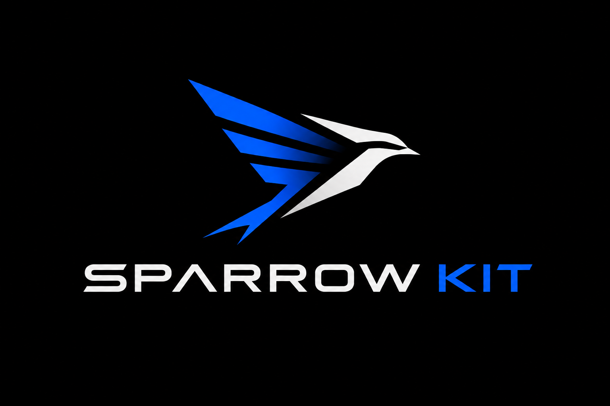

<div align="center">
  
  <h1>Sparrow Kit</h1>
  <p><strong>Real HTML. Server-rendered with Dart.</strong></p>
  <p>Build content-first web experiences with semantic markup, browser-native layout, and in-place hydration.</p>
  <p>
    <a href="https://dart.dev"></a>
    <a href="LICENSE"></a>
    <a href="https://github.com/MgThiha-Coding/sparrow_kit"></a>
  </p>
</div>

<p align="center">
  <a href="#why-sparrow-kit">Why Sparrow</a> &nbsp;·&nbsp;
  <a href="#quick-start">Quick start</a> &nbsp;·&nbsp;
  <a href="#the-build-workflow">Build workflow</a> &nbsp;·&nbsp;
  <a href="#documentation">Documentation</a>
</p>

---

## Why Sparrow Kit

Sparrow Kit is a Dart web framework and CLI for sites that should behave like
the web: meaningful HTML from the server, native browser layout, and
interactivity that attaches to the page already on screen.

<table>
  <tr>
    <td width="50%">
      <h3>HTML first</h3>
      <p>Render semantic elements and CSS layout instead of painting the UI to a Flutter canvas.</p>
    </td>
    <td width="50%">
      <h3>Useful before JavaScript</h3>
      <p>Serve page content and SEO metadata in the initial response, then hydrate the same DOM.</p>
    </td>
  </tr>
  <tr>
    <td width="50%">
      <h3>Focused reactivity</h3>
      <p>Signals patch bound text and attributes directly, without rebuilding unrelated nodes.</p>
    </td>
    <td width="50%">
      <h3>One build command</h3>
      <p>The CLI validates entry points, clears stale output, generates SSR pages, and compiles browser JavaScript.</p>
    </td>
  </tr>
</table>

Sparrow Kit is not a Flutter widget transpiler. Its Dart UI APIs are Sparrow
components, not arbitrary `package:flutter` widgets. It does not ship
Flutter's CanvasKit or Skwasm renderer for Sparrow UI; bundle size and runtime
performance still depend on your application, dependencies, and deployment.

## Quick start

### Install the CLI

The CLI is distributed from this Git repository:

```sh
dart pub global activate --source git https://github.com/MgThiha-Coding/sparrow_kit.git --git-path packages/sparrow_cli
```

Add Dart's global executable directory to `PATH`. On Windows, this is commonly
`%LOCALAPPDATA%\Pub\Cache\bin`.

### Create an app

```sh
sparrow init my_site
cd my_site
dart pub get
sparrow dev
```

The scaffold wires a shared page, browser hydration entry point, SSR entry
point, and `sparrow.json`. For an existing Dart package, run
`sparrow add web` from its app directory; existing files are left unchanged.

### Describe a page

The scaffold's `lib/home_page.dart` uses one UI description for both server
rendering and browser hydration:

```dart
import 'package:sparrow_kit/reactivity.dart';
import 'package:sparrow_kit/ui.dart';

UiNode buildHomePage(Signal<int> count) => Container(
      padding: 24,
      child: Column(
        gap: 12,
        crossAxisAlignment: CrossAxisAlignment.start,
        children: [
          Heading(1, 'Welcome to Sparrow Kit'),
          Row(
            gap: 8,
            children: [
              const Text('Visits: '),
              Text.bind('home_count', count),
            ],
          ),
          Button(
            label: 'Increment',
            onPressed: (_) => count.value++,
          ),
        ],
      ),
    );
```

`Text.bind` assigns a stable ID so SSR can serialize the initial signal value
and hydration can restore it. The initial UI contract includes common layout
and content primitives; it does not include Flutter's full widget catalogue
or implicit keyed child-list reconciliation.

## The build workflow

From a scaffolded app directory:

```sh
sparrow build web
```

The build reads `sparrow.json`. A scaffolded project uses a configuration like:

```json
{
  "web": {
    "client": "web/main.dart",
    "server": "server/site.dart",
    "output": "build/web",
    "clientOutput": "main.dart.js"
  }
}
```

The CLI then:

1. Analyzes the configured client and server entry points.
2. Clears the output directory and copies non-Dart assets from `web/`.
3. Runs the server entry point to generate the declared SSR routes and HTML.
4. Compiles the client entry point with `dart compile js -O2`.

### Build this repository's landing page

Resolve workspace dependencies from the repository root, then build from the
configured app directory:

```sh
dart pub get
cd apps/web_app
dart run sparrow_cli build web
```

[`apps/web_app/sparrow.json`](apps/web_app/sparrow.json) connects
`web/main.dart` to the static-site generator in `bin/site.dart`. Both use the
same landing-page description from `lib/`; browser hydration attaches the
portfolio filters to the server-rendered page. The production output is
`apps/web_app/build/web`.

The CLI orchestrates the entry points you provide; it does not infer routes
from `lib/`, translate Flutter widgets, or replace `flutter build web`. Your
server entry point owns the route list and the metadata rendered for each
page.

## SSR, hydration, and SEO

Sparrow Kit renders semantic markup and serialized signal state into the
initial HTML response. The browser rebuilds the matching UI description,
verifies it against the existing DOM, and attaches event handlers and reactive
bindings without replacing the server markup. Keep the server and client
trees and serialized signal IDs consistent.

Pass `HeadMetadata` from the server route to render titles, descriptions,
canonical links, Open Graph and Twitter tags, and JSON-LD. The framework
provides the mechanisms; your app supplies accurate page-specific values and
public URLs. No framework can guarantee indexing, rankings, or rich-result
eligibility across search engines.

## Runtime and compatibility

- Dart SDK `>=3.6.0 <4.0.0` to build the app and generate SSR HTML
- A modern browser for DOM rendering and hydration

`sparrow build web` writes static HTML, JavaScript, and assets to `build/web`;
serving that output does not require a Dart server. `sparrow dev` runs a local
Dart development server. For request-time SSR, use `StringRenderer` from your
own Dart HTTP handler; Sparrow Kit provides rendering primitives, not a
production HTTP server adapter.

`Text`, `Row`, `Column`, `Container`, `Heading`, and `Button` are Sparrow Kit
APIs, not Flutter widgets. The initial layout contract uses CSS flexbox;
Flutter render objects, custom painting, implicit Flutter themes, and Flutter
package compatibility are outside its scope.

## Documentation

| Guide | What it covers |
| --- | --- |
| [Getting started](docs/getting-started.md) | Install, scaffold, and build your first page |
| [UI contract and web build](docs/ui-contract-and-build.md) | Supported components and CLI configuration |
| [SSR, hydration, and SEO](docs/ssr-and-seo.md) | Rendering, metadata, structured data, and hydration |
| [Architecture](docs/architecture.md) | DOM rendering, signals, and component lifecycle |
| [Routing and state](docs/routing-and-state.md) | Routes, navigation, and reactive state |

<p align="center">
  <sub>Open source under the <a href="LICENSE">MIT License</a>.</sub>
</p>
